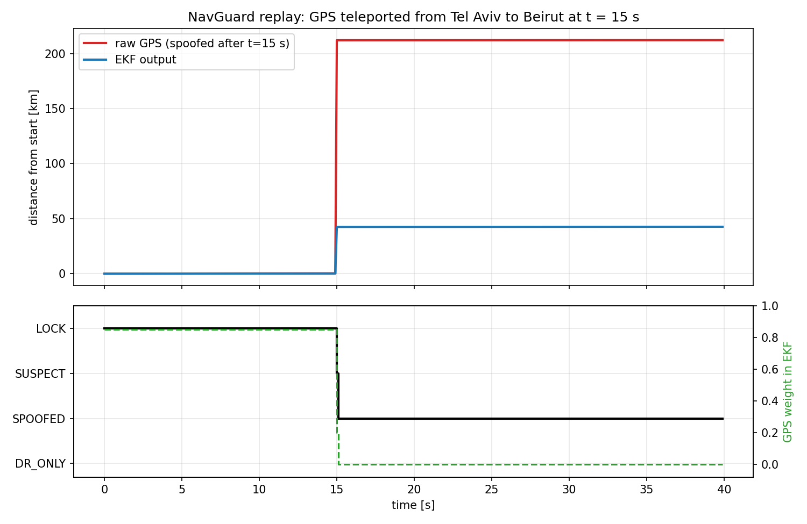
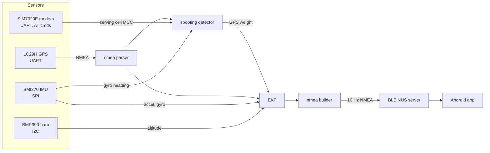

# navguard-firmware

GPS anti-spoofing firmware for an in-car device (ESP32-S3, ESP-IDF 5.x, FreeRTOS).
It reads GPS, IMU, barometer and cellular data, fuses them in an Extended Kalman
Filter, detects GPS spoofing, and streams clean NMEA over BLE to an Android
companion app that feeds it to Waze / Google Maps as the phone's location.

The pure-logic core (NMEA, EKF, spoofing detector, AT-command parser) builds and
runs on a laptop with CMake. Every hardware driver has a mock backend and a real
backend behind one interface, so the logic was validated before any hardware
existed.

> **בעברית:** קושחה למכשיר רכב שמזהה זיוף GPS. המכשיר משלב GPS, חיישן תאוצה וסיבוב,
> ברומטר ומודם סלולרי בפילטר קלמן, מזהה כשה-GPS "קופץ" למקום אחר, ושולח מיקום נקי
> לטלפון ב-BLE. את כל הקושחה כתבתי לבד. הפרויקט נעצר לפני ייצור החומרה, אבל כל שכבת
> הלוגיקה נבדקת על המחשב, כולל הרצה של מסלול מזויף מקצה לקצה.



*Replay of a synthetic drive: at t = 15 s the GPS is teleported from Tel Aviv to
Beirut. The detector goes `LOCK → SUSPECT → SPOOFED` within two fixes (100 ms)
and the EKF stops trusting GPS. The 42 km step in the EKF output is a known
issue, described [below](#known-issues).*

## Status

**Stopped before hardware production (2026).** The device hardware turned out
too expensive for an ordinary driver, which narrowed the market to professional
drivers and high-end cars. At the same time GPS disruption in Israel became much
less frequent, and the remaining demand was mostly in markets we did not want to
limit ourselves to.

The firmware was written by me (Daniel B), end to end. What exists today:

| Part | State |
|------|-------|
| NMEA 0183 parser and builder | Done, unit-tested |
| EKF sensor fusion + geo math | Done, unit-tested |
| 4-state spoofing detector | Done, unit-tested |
| SIM7020E AT-command parser (cell tower info) | Done, unit-tested |
| Replay harness (full pipeline on desktop) | Done |
| Mock drivers (GPS, IMU, baro, cell) | Done, used by tests and replay |
| Real drivers: LC29H (UART), BMI270 (SPI), BMP390 (I2C), SIM7020E (UART) | Written against datasheets, **never run on hardware** |
| BLE Nordic UART Service server (NimBLE) | Written, not tested on a device |
| HTTPS OTA update | **Skeleton only** — see known issues |

## Architecture



Five FreeRTOS tasks share the EKF state through a mutex:

| Task | Priority | Rate | Job |
|------|----------|------|-----|
| `imu` | 6 (highest) | 400 Hz | EKF predict step (dead reckoning) from accelerometer and gyro |
| `gps` | 5 | 10 Hz | parse NMEA, run the spoofing checks, EKF GPS update |
| `output` | 5 | 10 Hz | build RMC/GGA from the EKF state, notify over BLE |
| `cell` | 3 | 1 Hz | read serving cell (MCC/MNC/cell ID) over AT commands, cell-anchor check |
| `baro` | 3 | 5 Hz | EKF altitude update |

The IMU task has the highest priority because dead reckoning degrades fastest
if prediction steps are missed; slow sensors run at the lowest priority.

## Spoofing detector

| State | GPS weight | Meaning |
|-------|-----------|---------|
| `GPS_LOCK` | 0.85 | all checks pass |
| `GPS_SUSPECT` | 0.20 | one check failed, evaluating |
| `GPS_SPOOFED` | 0.00 | cell anchor / teleport contradicts GPS |
| `DR_ONLY` | 0.00 | no GPS (tunnel / jamming) — dead reckoning |

Checks:

- **Innovation velocity gate** — the GPS jump may exceed the EKF-expected travel
  by at most 50 km/h. Catches teleports while tolerating highway speed.
- **Heading consistency** — GPS-derived turn vs gyro-integrated turn.
- **Cell anchor** (definitive) — the serving tower's MCC is not 425 while GPS
  claims to be in Israel ⇒ spoofed.

## Known issues

- **The first spoofed fix leaks into the EKF.** On the fix where the detector
  moves from `LOCK` to `SUSPECT`, the EKF update still applies that fix with the
  `SUSPECT` weight (0.20). With a 210 km teleport this pulls the estimate about
  42 km before the next fix switches to `SPOOFED` (see the figure). The gate
  should reject the measurement that failed the check instead of fusing it at a
  reduced weight.
- **OTA is a skeleton.** WiFi connection from NVS is stubbed out, TLS server
  verification is off (`crt_bundle_attach = NULL`), and the BLE command that
  triggers OTA is not authenticated, so any BLE client could point the device at
  a firmware URL. Production would need BLE pairing/bonding, a certificate
  bundle, and signed images with secure boot.
- **Real drivers are untested.** They follow the datasheets but never ran on
  hardware.

## Desktop build and tests (no hardware)

```bash
cmake -S . -B build-desktop -DTARGET=desktop -DCMAKE_BUILD_TYPE=Debug
cmake --build build-desktop
(cd build-desktop && ctest --output-on-failure)
```

Five suites run: `test_nmea_parser`, `test_nmea_builder`, `test_ekf`,
`test_spoof_detect`, `test_at_parser`.

### Replay a track through the full pipeline

```bash
./build-desktop/navguard_replay test_data/tel_aviv_spoof.nmea > out.csv
python3 tools/plot_replay_figure.py out.csv docs/replay_spoof.png   # the figure above
python3 tools/plot_ekf.py out.csv                                   # track on a map plot
```

Both scripts need `matplotlib`.

### Generate test data

```bash
python3 tools/gen_test_nmea.py            > test_data/tel_aviv_drive.nmea
python3 tools/gen_test_nmea.py --spoof    > test_data/tel_aviv_spoof.nmea
```

The tracks are synthetic. Real recordings (for example an NMEA export from a
phone GPS logger) would exercise more edge cases: multipath, HDOP changes and
timing jitter.

## ESP32-S3 build

```bash
. $IDF_PATH/export.sh
idf.py set-target esp32s3
idf.py build flash monitor
```

Driver selection lives in `main/main.c`. Bring-up swaps each mock for its real
backend one at a time:

```c
s_gps  = lc29h_get_uart_driver();      // was lc29h_get_mock_driver(...)
s_imu  = bmi270_get_spi_driver();
s_baro = bmp390_get_i2c_driver();
s_cell = sim7020e_get_uart_driver();
```

## Layout

```
components/
  nmea/        NMEA 0183 parser + builder            (desktop-tested)
  ekf/         Extended Kalman Filter + geo math      (desktop-tested)
  spoofing/    4-state spoofing detector              (desktop-tested)
  drivers/     lc29h (GPS/UART), bmi270 (IMU/SPI),
               bmp390 (baro/I2C), sim7020e (cell/UART) — mock + real backends
  ble_server/  Nordic UART Service GATT server (NimBLE)
  ota/         WiFi HTTPS OTA update (skeleton)
main/main.c    FreeRTOS task wiring
tools/         replay harness, NMEA generator, plotting scripts
test_data/     synthetic Tel Aviv tracks (normal + spoofing)
docs/          README figure
```

## License

[MIT](LICENSE)
